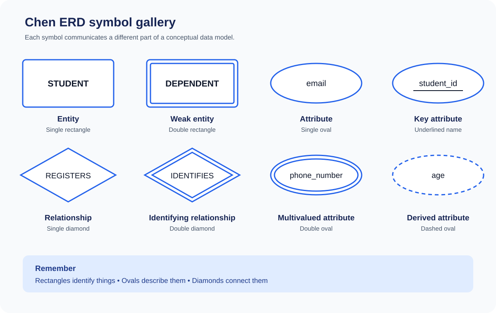

# 02 — Conceptual Database Design and ER Modelling

**VU CS403 handout:** Lectures 7–13  
**Related assignments:** [Assignment 01 — Examination System](../assignments/assignment-01-examination-system-design.md) · [Assignment 02 — University Database ERD](../assignments/assignment-02-university-database-erd.md)

This section teaches the steps needed to understand and draw an Entity–Relationship Diagram (ERD). Study it in order.

## Interactive Chen ERD symbol guide

This guide uses **Chen notation**, a conceptual ERD notation taught in many introductory database courses. Select each symbol below to expand its explanation, use case, and a practical example. The visual gallery gives you a quick reference.

> **The basic idea:** rectangles identify the things we store data about, ovals describe those things, and diamonds show how those things are associated.

### 1. Entity — single rectangle

<strong>Open: Entity rectangle</strong> · What does it represent?

An **entity type** is a category of real-world object, person, place, event, or concept that the database needs to keep information about.

Examples in a university system: STUDENT, COURSE, INSTRUCTOR, DEPARTMENT, TEXTBOOK.

**Why a rectangle?** It gives each entity type a clear boundary in the model. Attributes and relationships can then be connected to the correct entity.

**How to decide:** Ask, “Does the system need to remember multiple instances of this thing and facts about each instance?” If yes, it may be an entity.

**Example:** STUDENT is the entity type; student VU-1024 is one entity instance.

**Common mistake:** Drawing student_name as an entity. A name describes a student, so it is an attribute, not a separate entity in this simple model.

### 2. Weak entity — double rectangle

<strong>Open: Weak entity</strong> · When is an entity dependent?

A **weak entity type** cannot be uniquely identified by its own attributes alone. It is identified in the context of an owner (strong) entity, usually using the owner's key plus a **partial key** belonging to the weak entity.

**Example:** DEPENDENT belongs to an EMPLOYEE. Two employees may each have a dependent named Ali. dependent_name alone is not globally unique; a possible identifier is (employee_id, dependent_name).

**Why a double rectangle?** It distinguishes the dependent entity type from a regular strong entity.

**Use it when:** the requirements establish identifier dependency on an owner entity. Weak does not simply mean “less important” or “optional”.

**Common mistake:** Calling every entity with a foreign key weak. An entity can have its own primary key and still reference another entity; that alone does not make it weak.

### 3. Attribute — single oval

<strong>Open: Attribute oval</strong> · What does it describe?

An **attribute** is a property that describes an entity or, in some cases, a relationship.

For STUDENT, possible attributes include student_id, first_name, email, and date_of_birth.

**Why an oval?** It visually separates descriptive properties from the entity type itself.

**How to decide:** Ask, “Is this a fact about an entity, rather than a thing the database needs to manage independently?”

**Common mistake:** Treating an attribute as an entity just because it has a name. An email address is usually a STUDENT attribute in a simple model; it becomes a separate entity only if the requirements need to manage it independently or associate it with other facts.

### 4. Key attribute — underlined name inside an oval

<strong>Open: Key attribute</strong> · How do we identify an instance?

A **key attribute** uniquely identifies an entity instance. In Chen notation, underline the attribute name inside its oval.

Example: student_id identifies one student, assuming the university guarantees that it is unique and non-null.

**Why underline it?** The reader can distinguish the identifier from ordinary descriptive attributes immediately.

A key can also be composite: two or more attributes together identify an instance. In that case, underline each participating key attribute in the ERD.

**Do not assume:** Names, phone numbers, and email addresses are unique unless the business rules guarantee it.

### 5. Relationship — single diamond

<strong>Open: Relationship diamond</strong> · How are entities connected?

A **relationship** represents a meaningful association between entity types. Its name is usually a verb or verb phrase.

Example: STUDENT — REGISTERS — COURSE.

The diamond represents REGISTERS; the rectangles represent STUDENT and COURSE.

**Why a diamond?** A connecting line alone only shows that two items are linked. The diamond names the meaning of the association.

Relationships can be:
- **Unary (recursive):** an entity type relates to itself, e.g. EMPLOYEE supervises EMPLOYEE.
- **Binary:** two entity types participate, e.g. STUDENT registers for COURSE.
- **Ternary:** three entity types participate in one relationship.

The diamond does **not** tell you the cardinality by itself. You must also specify how many instances can participate, using the notation required by your course.

### 6. Identifying relationship — double diamond

<strong>Open: Identifying relationship</strong> · How is a weak entity identified?

The **identifying relationship** connects a weak entity to its owner entity. In traditional Chen notation, it is drawn as a double diamond.

Example: EMPLOYEE — HAS — DEPENDENT.

The weak entity is the double rectangle; the identifying relationship is the double diamond. These are two different symbols and should not be confused.

The owner's key participates in identifying the weak entity, along with the weak entity's partial key.

**Use it when:** the dependent entity's identification relies on the owner, not merely because a relationship happens to exist.

### 7. Multivalued attribute — double oval

<strong>Open: Multivalued attribute</strong> · Can one instance have several values?

A **multivalued attribute** can hold more than one value for a single entity instance.

Example: one STUDENT may have several phone numbers.

**Why a double oval?** It marks an attribute whose value is a collection rather than one single value.

**Important distinction:** Multivalued does not mean composite.
- Multivalued: one student has several phone numbers.
- Composite: one address can be split into street, city, and postal code.

When converting an ER model to relational tables, a multivalued attribute is usually represented in a separate relation rather than storing a list in one column.

### 8. Derived attribute — dashed oval

<strong>Open: Derived attribute</strong> · Can the value be calculated?

A **derived attribute** is calculated from other data rather than necessarily stored as an independent value.

Example: age can be calculated from date_of_birth and the current date.

**Why a dashed oval?** The dashed outline indicates that the value is derived.

**Use it when:** the value can reliably be computed from other attributes and the model should make that fact clear.

**Design caution:** Age changes over time. Storing a person's date of birth and calculating age when needed avoids an age value becoming stale.

### 9. Composite attribute — one oval with component ovals

<strong>Open: Composite attribute</strong> · Can an attribute be broken into parts?

A **composite attribute** can be divided into smaller components that have their own meaning.

Example: address may contain street, city, and postal_code. Name may contain first_name and last_name.

In Chen notation, draw one oval for the composite attribute and connect it to smaller ovals for its components.

**Use it when:** users or processes need to refer to the components separately.

**Common mistake:** Confusing a composite attribute with a multivalued attribute. A composite attribute has meaningful parts; a multivalued attribute has multiple values.

### Lines and relationship constraints — also important

The shapes identify model elements, but the connecting lines and their annotations communicate participation and cardinality. These are not extra entity shapes, but they are essential to a readable ERD.

<strong>Open: Cardinality and participation</strong> · How many, and is participation required?

**Maximum cardinality** describes the maximum number of related instances:
- 1:1 — one to one.
- 1:M — one to many.
- M:N — many to many.

**Minimum participation** describes whether participation is optional or mandatory:
- Minimum 0 — optional.
- Minimum 1 — mandatory.

In traditional Chen notation, a **single line** commonly indicates partial/optional participation, while a **double line** indicates total/mandatory participation. Follow the exact notation used by your instructor.

Example business rule:
- A department may have zero or many employees.
- Every employee must belong to exactly one department.

This is a 1:M relationship from DEPARTMENT to EMPLOYEE, with optional participation on the department side and mandatory participation on the employee side.

Do not infer minimum participation from “one-to-many” alone. The scenario must state or imply whether participation is required.

### Interactive knowledge checks

Try to answer each question before opening its explanation.

<strong>Check 1:</strong> A university stores information about STUDENT. Which shape represents STUDENT?

**Answer: Single rectangle.** STUDENT is an entity type: a category of things the database manages.

<strong>Check 2:</strong> One student can have multiple phone numbers. Which attribute symbol applies?

**Answer: Double oval.** The attribute is multivalued because one student can have several phone-number values.

<strong>Check 3:</strong> A dependent is identified using the employee's ID and the dependent's name. Which two special symbols are relevant?

**Answer: Double rectangle and double diamond.** DEPENDENT is the weak entity; the relationship connecting it to EMPLOYEE is the identifying relationship.

<strong>Check 4:</strong> Age is calculated using date of birth. How should age be shown?

**Answer: Dashed oval.** Age is a derived attribute.

<strong>Check 5:</strong> A student's name is split into first name and last name. Is it multivalued?

**Answer: No.** It is composite: one name attribute has meaningful components. A multivalued attribute would allow several name values for the same student.

### Before drawing or submitting an ERD

- [ ] Entity types use single rectangles.
- [ ] Weak entity types use double rectangles only when identifier dependency exists.
- [ ] Attributes use ovals and connect to the entity or relationship they describe.
- [ ] Key attributes are underlined.
- [ ] Composite attributes connect to their component ovals.
- [ ] Multivalued attributes use double ovals.
- [ ] Derived attributes use dashed ovals.
- [ ] Relationships use diamonds and meaningful names.
- [ ] Identifying relationships use double diamonds for weak entities.
- [ ] Cardinality and minimum participation match the written business rules.
- [ ] The diagram uses one notation consistently and remains readable.

**Notation warning:** This is Chen-style notation. Crow's-foot diagrams use a different visual convention, especially at relationship ends. Do not mix Chen diamonds and Crow's-foot endpoint symbols in one diagram unless your instructor specifically asks for a hybrid.

---

---

## Lecture 7 — Entities and attributes

### What is an ER model?
The Entity–Relationship (ER) model is a semantic data model used to represent conceptual database design graphically. It is implementation-independent: it describes the information and relationships an organization needs before a DBMS is selected.

Its three main constructs are **entities, attributes, and relationships**.

### Entity type, instance, and set
- **Entity type:** a category of things with common properties, e.g. STUDENT.
- **Entity instance:** one particular member of that category, e.g. student S104.
- **Entity set:** the collection of instances of an entity type, e.g. all students.

A useful test: does the system need to store multiple instances of this kind of thing and remember properties about them?

### Strong and weak entities
- **Strong entity type:** its instances can exist independently and have their own identification.
- **Weak entity type:** its instances depend on another entity type for existence.

The handout's example is an employee-owned vehicle record that depends on the employee record. In the handout's notation, a strong entity uses a single rectangle and a weak entity a double rectangle.

### Attributes and domains
An **attribute** describes a property of an entity type. A **domain** is the set of legal values for an attribute. For example, a credit-hours attribute should have a numeric domain with a sensible permitted range. Domains help prevent invalid values.

| Attribute type | Meaning | Example |
|---|---|---|
| Simple | Not usefully divided into smaller parts | A code |
| Composite | Can be divided into meaningful components | Address: street, city |
| Single-valued | One value per entity instance | Date of birth |
| Multi-valued | Multiple values may be associated with an instance | Phone numbers |
| Stored | Value is retained in the database | Date of birth |
| Derived | Calculated from other values | Age derived from date of birth |

The handout's attribute notation uses ovals; a composite attribute connects to its components, a multi-valued attribute uses a double oval, a derived attribute uses a dashed oval, and a key attribute is underlined.

### Worked example
For STUDENT, possible attributes are registration number, name, date of birth, and email. Registration number may identify a student. One instance could be (VU-1024, Ayesha Khan, 2004-03-12, ayesha@example.test). The entity type defines the structure; the instance supplies actual values. This is fictional data.

## Lecture 8 — Keys

A **key** is an attribute or combination of attributes used to identify an entity instance.

| Key type | Meaning |
|---|---|
| Super key | One or more attributes that uniquely identify an instance |
| Candidate key | A minimal super key; no proper subset is still a key |
| Primary key | The candidate key selected as the main identifier |
| Alternate key | A candidate key not selected as primary |
| Secondary key | Used for searching; uniqueness is not guaranteed |

A **composite key** contains more than one attribute. A primary key must uniquely identify an instance and cannot be NULL.

### Worked example
Assume STUDENT has attributes regNo, nationalId, name, and city. If regNo and nationalId are each unique:
- regNo and nationalId are candidate keys.
- If regNo is selected as primary, nationalId is an alternate key.
- city can be a secondary search key because many students may live in the same city.
- (regNo, name) is a super key but not a candidate key because regNo alone is sufficient.

**Common mistake:** using a person's name as a primary key. Names can repeat and may change.

## Lecture 9 — Relationships

A **relationship** is a meaningful association between entity types. Examples: a student registers for a course; an instructor teaches a course; a department offers a course. A relationship should have a clear name and meaning.

### Relationship degree
Degree tells how many entity types participate:
- **Unary / recursive:** an entity type relates to itself, e.g. an employee supervises another employee.
- **Binary:** two entity types participate, e.g. STUDENT registers for COURSE.
- **Ternary:** three entity types participate in one relationship.
- **N-ary:** more than three entity types participate.

Do not confuse relationship degree with cardinality.

### Relationship cardinality
Cardinality describes how many instances on one side can be associated with an instance on the other.

| Type | Meaning | Example |
|---|---|---|
| 1:1 | At most one on each side | Person–Passport, if rules permit one passport per person |
| 1:M | One on one side can relate to many on the other | Department–Employee |
| M:1 | Many on one side relate to one on the other | Employee–Department |
| M:N | Many on each side can relate to many on the other | Student–Course |

### Relationship attributes
A fact may belong to the association rather than either entity alone. For example, registrationDate describes a student's registration in a particular course, not the student generally or the course generally.

### Worked ER diagram — Department and Employee

Consider this separate example with the following business rules:
- A department may have zero or many employees.
- Every employee must belong to exactly one department.

~~~mermaid
erDiagram
    DEPARTMENT ||--o{ EMPLOYEE : employs
    DEPARTMENT {
        int departmentId PK
        string departmentName
    }
    EMPLOYEE {
        int employeeId PK
        string employeeName
        int departmentId
    }
~~~

Read the symbols from the relationship ends:
- `||` means exactly one.
- `o{` means zero or many.

So one department can be related to multiple employees, while each employee is related to exactly one department. The rules above are assumptions for this example, not universal rules for every organization.

Try changing the rule to allow employees who are not assigned to a department. Which end of the relationship would need optional participation?

## Lecture 10 — Minimum cardinality, roles, and dependencies

### Maximum and minimum cardinality
- **Maximum** tells the greatest number of related instances allowed.
- **Minimum** tells the least number required.
- Minimum 0 means optional participation.
- Minimum 1 means mandatory participation.

In min/max notation, 0..* means zero or many; 1..1 means exactly one. Read each end carefully and use one notation consistently. The scenario and business rules determine the cardinalities; do not guess them.

### Roles and recursive relationships
A **role** describes how an entity participates in a relationship. Roles are especially useful when an entity relates to itself or when two entity types have more than one relationship. For example, an instructor may teach a student and separately supervise that student's project. Label the roles to avoid ambiguity.

### Dependencies
The handout distinguishes:
- **Existence dependency:** an entity instance cannot exist without a related instance of another entity.
- **Identifier dependency:** the dependent entity uses the parent's identifier as part of its own identification.
- **Referential dependency:** the dependent entity has its own identifier but also refers to a parent through a reference attribute.

These ideas help decide whether an entity is dependent and how its identity and participation should be represented.

## Lectures 10–11 — Supertype, subtype, and inheritance

A **supertype** stores properties shared by a general category. A **subtype** represents a more specific category and inherits common properties from its supertype.

Example: PERSON may be a supertype, with STUDENT and INSTRUCTOR as subtypes. Shared attributes such as name belong at PERSON level; student-specific or instructor-specific attributes belong in their subtype.

Two independent constraints apply:

**Completeness**
- **Total:** every supertype instance must belong to at least one subtype.
- **Partial:** a supertype instance may belong to no subtype.

**Disjointness**
- **Disjoint:** one supertype instance can belong to only one subtype in the classification.
- **Overlapping:** one supertype instance may belong to multiple subtypes.

The four combinations are complete-disjoint, complete-overlapping, partial-disjoint, and partial-overlapping. A **subtype discriminator** is an attribute used to indicate which subtype an instance belongs to.

Do not add a subtype hierarchy just because two entities share one attribute. Use it only when the requirements support a genuine general/specialized relationship.

## Lectures 12–13 — Examination-system case study

The handout uses an educational institute's examination system to demonstrate analysis and conceptual design.

### Understand the system
The case study describes students enrolled in programs; programs based on courses; courses offered in semesters; students registering for offered courses subject to prerequisites; teachers assigned to course offerings; teachers submitting assessment marks; and results/GPA calculated from student performance.

### Users and outputs
The handout identifies students, teachers, and the controller's office as participants. Outputs include transcripts, semester result cards, attendance sheets, and class results.

### From analysis to ERD
1. Use DFDs to understand processes and data movement.
2. List outputs and their required data items.
3. Use a cross-reference matrix to relate report fields to outputs.
4. Identify candidate entity types and attributes.
5. Identify relationships and cardinalities.
6. Draw the ERD and validate it against required outputs.

The handout's candidate entities include STUDENT, COURSES, TEACHERS, PROGRAMS, SEMESTER, and COURSE OFFERED. It discusses why a single controller instance need not be an entity type and why “results” requires careful analysis rather than being added as one vague entity.

The case study relationships include PROGRAM–COURSE, STUDENT–PROGRAM, SEMESTER–COURSE through COURSE OFFERED, COURSE OFFERED–TEACHER, STUDENT–COURSE OFFERED through ENROLLED, and STUDENT–SEMESTER through result/GPA information.

The key lesson is that an ER model must support the required outputs. If an attendance sheet or transcript cannot be produced from the model, revisit the entities, attributes, and relationships before moving to logical design.

## A repeatable method for any ERD assignment

1. **Extract nouns:** list candidate entity types.
2. **Check each noun:** does the system need to store multiple instances and their properties?
3. **Extract facts:** list attributes required for each entity.
4. **Choose identifiers:** select keys that uniquely identify instances.
5. **Extract verbs:** turn meaningful associations into named relationships.
6. **Set degree and cardinality:** identify unary/binary/ternary and 1:1, 1:M, M:N.
7. **Set minimum participation:** decide optional or mandatory participation from stated rules.
8. **Check relationship attributes:** put facts such as registration date on the association when appropriate.
9. **Draw and validate:** use consistent notation and check required outputs.

## Practice before attempting assignments

1. Identify entities and attributes for a library system.
2. Explain entity type, instance, and entity set.
3. Give one strong and one weak entity example.
4. For STUDENT(regNo, nationalId, name, city), identify candidate keys if regNo and nationalId are unique.
5. Classify Student–Course by degree and cardinality.
6. Explain 0..* versus 1..*.
7. Give a recursive relationship and label both roles.
8. Give an example of total completeness and disjointness.

## Assignments

- [Assignment 01 — Examination System Design](../assignments/assignment-01-examination-system-design.md)
- [Assignment 02 — University Database ER Diagram](../assignments/assignment-02-university-database-erd.md)

For Assignment 02, focus first on Lectures 7–10: entity/attribute identification, keys, relationships, and minimum/maximum cardinality. Lectures 11–13 provide additional modelling context and the handout's case study.

## Next
Continue to [03 — Relational Data Model](../03-relational-data-model/README.md). Conceptual ER design is not yet a set of relational tables.
